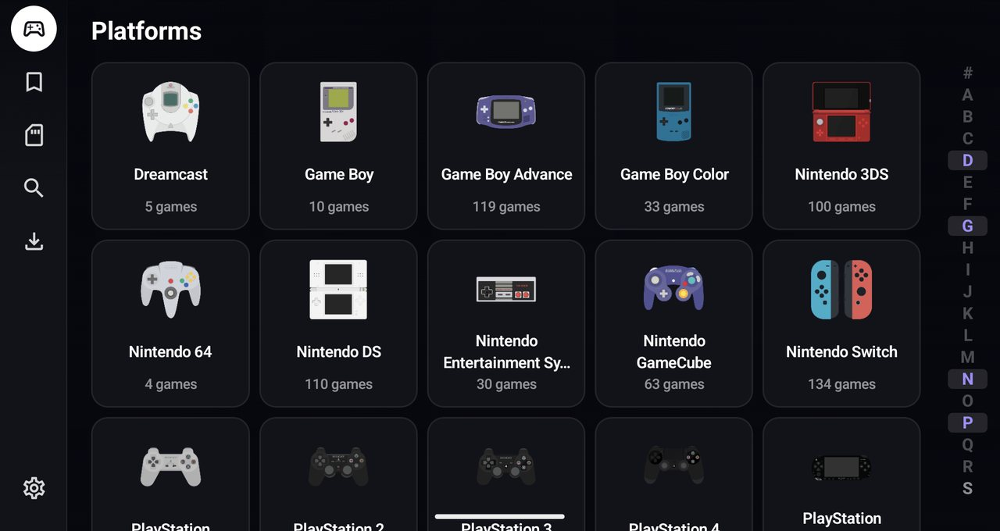
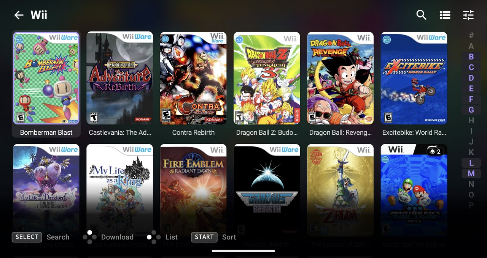
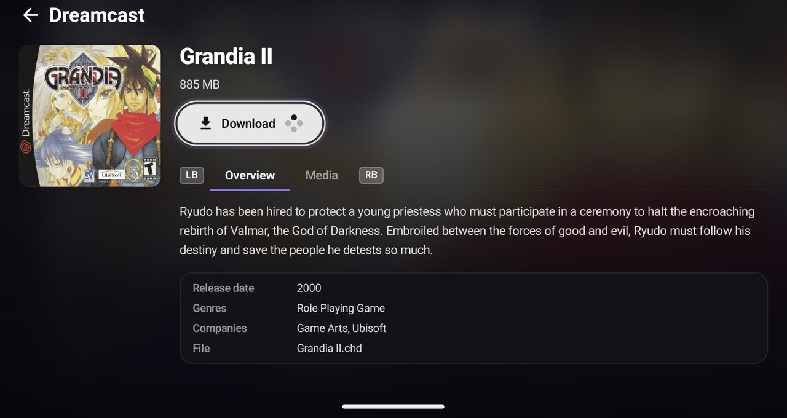
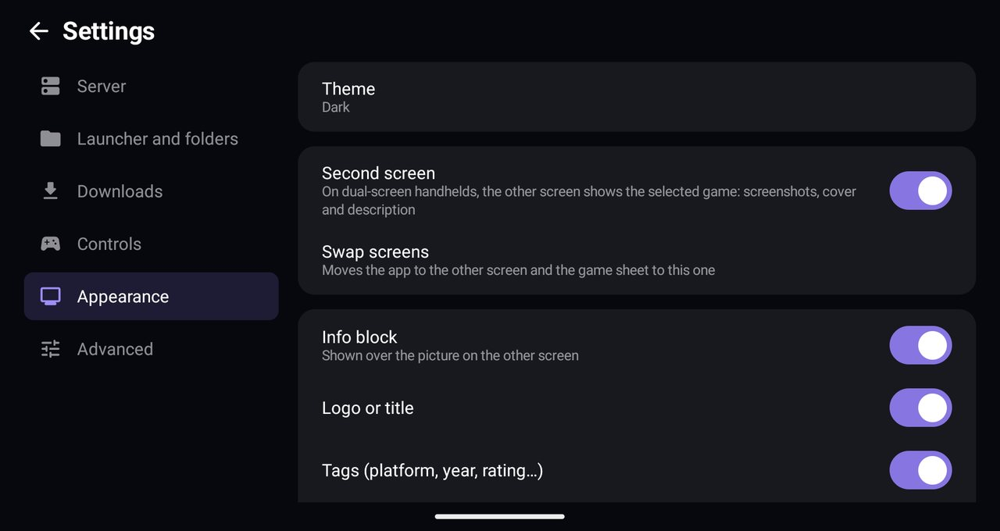
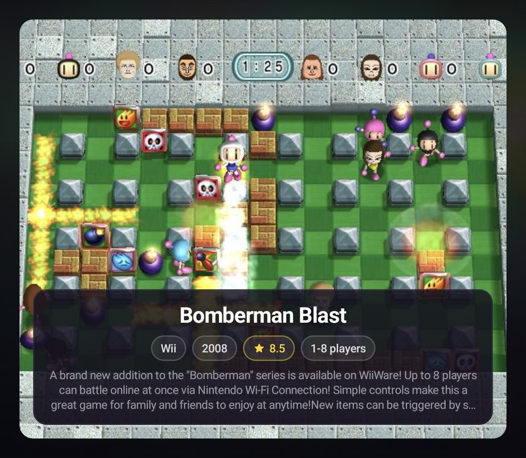
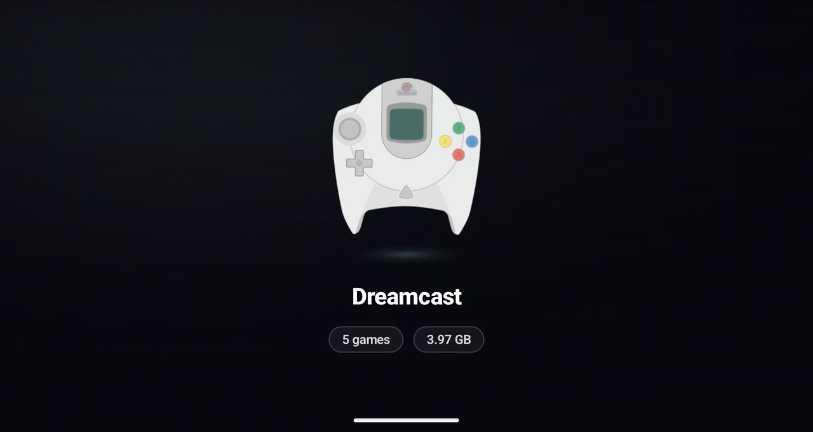
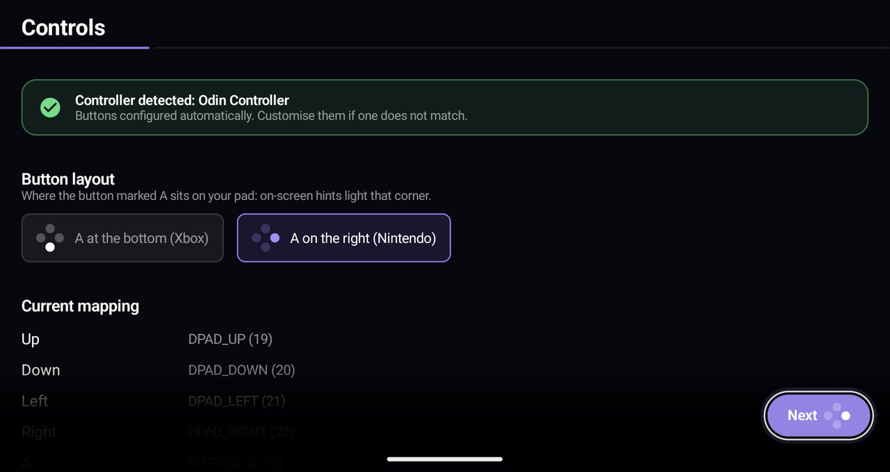

# RomMMobile (fork)

Android app for **[RomM](https://romm.app)**: browse your RomM library and download games straight into your frontend's folders (ES-DE, Daijishō, Pegasus…), entirely from the gamepad. It does not launch games; your frontend does.

> **Personal fork.** This is a fork of [pippopapera/RomMMobile](https://github.com/pippopapera/RomMMobile) made for my own use on an AYN Thor and shared with a few friends. It restyles the app after the RomM web v2 interface and adds a second-screen view. No support or roadmap promised, not affiliated with RomM or the original project. For the original app, see [its releases](https://github.com/pippopapera/RomMMobile/releases).

| Platforms | Game list |
|---|---|
|  |  |
| **Game page** | **Settings** |
|  |  |
| **Second screen: game** | **Second screen: platform** |
|  |  |
| **Setup** | |
|  | |

## Install

Add it in [Obtainium](https://github.com/ImranR98/Obtainium) (badge above, or `https://github.com/Celthium/RomMMobile`) to get updates, or download the APK from the [latest release](https://github.com/Celthium/RomMMobile/releases/latest).

It installs as its own app (`com.celthium.rommmobile`), next to the original. Needs a **RomM 5.x** server, **Android 8+** and a frontend already set up.

## What's in this fork

- **RomM v2 look**: side rail, covers at their real ratio, game page with Overview / Media / Files tabs.
- **Second screen** (dual-screen handhelds): the other screen shows the platform or game under the cursor, with clips and screenshots. Screens can be swapped.
- **Setup from the pad**: controller detected and mapped automatically, Xbox or Nintendo button layout, QR-code sign-in.
- **Downloads**: DLC, updates, mods and BIOS per file; X on a grid downloads the game.
- **Settings** by category, **French** translation.

From the original app: library, collections, search, installed shelf, download queue, automatic folder mapping, LAN / remote addresses.

## Controls

| Button | Action |
|---|---|
| A / B | Open / back |
| X | Download the game under the cursor |
| Y | Grid / list |
| L1 / R1 | Previous / next letter or tab |
| L2 / R2 | Previous / next section |
| Start / Select | Sort / search |
| L3 / R3 | Search / download queue |

## Build

JDK 17+ and the Android SDK (platform 37), then `./gradlew :app:assembleRelease`. Without a `releaseSigning=` entry in `local.properties` the APK is signed with the debug key. Design and architecture notes are in [`docs/`](docs/).

## License

[MIT](LICENSE). Original app by [pippopapera](https://github.com/pippopapera/RomMMobile).
